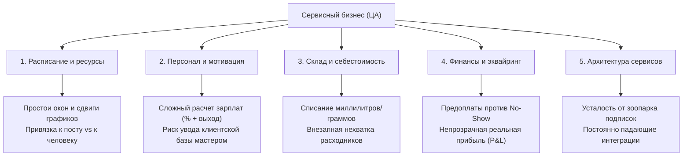

# Анализ целевой аудитории (ЦА) сферы услуг на основе эмпирических данных 20 956 компаний YClients

**Назначение документа:** Справочник для продуктовой команды, маркетинга, продаж и клиентского сервиса компании «Молния Тех».  
**Дата актуализации данных:** Ноябрь 2026 года.  
**Эмпирическая база исследования:** 20 956 верифицированных отзывов компаний на ТОП-3 интеграции маркетплейса YClients («Большая тройка»: *Wahelp* — 3 917, *Бьюти Бот* — 8 869, *Чат-Пуш* — 8 170).  
**Уникальных коммерческих предприятий в выборке:** 18 923 организации.  
**Первоисточник данных:** [Google Таблица исследования (20 956 компаний)](https://docs.google.com/spreadsheets/d/1aOBRpB7527DRNIZD2DrFzT9KEbiyLDU7x3WyHluo458/edit).

---

## 1. Методологическая оговорка: уведомления как верхушка айсберга

Анализируемый массив данных сформирован на основе отзывов к сервисам чат-ботов и рассылок уведомлений (WhatsApp, Telegram, SMS). Это порождает важное продуктовое наблюдение:

> **Критический вывод:** Тот факт, что десятки тысяч компаний ежемесячно платят от 1 500 до 6 000 ₽ сверх базовой подписки за сторонние надстройки рассылок, демонстрирует **острейший симптом**, но **не исчерпывает саму проблему**.

Уведомления — это лишь внешний коммуникационный инструмент. Потребность в них вызвана глубинными экономическими и операционными разрывами в бизнес-процессах сервисных предприятий.

---

## 2. Симптом vs Коренная причина (Почему бизнес покупает ботов)

| Что бизнес декларирует (Симптом) | Какая реальная экономическая боль стоит за этим (Коренная причина) |
| :--- | :--- |
| *«Нам нужны автоматические напоминания о записи в WhatsApp»* | **Цена неявки (No-Show).** Если клиент не пришел на сложное окрашивание, сложное лечение зуба или детейлинг (окно 3–4 часа), бизнес получает прямой кассовый разрыв: мастер простаивает (при этом бизнес часто платит за выход), аренда капает, выручка равна нулю, а новое окно оперативно закрыть невозможно. |
| *«Администратор не успевает отвечать клиентам»* | **Человеческий фактор и потеря лидов.** В пиковые часы или нерабочее время (вечер, ночь) клиент ждет ответа более 15 минут, теряет терпение и уходит к конкуренту на соседней улице. Администраторы забывают предложить альтернативное время или теряют диалоги в личных мессенджерах. |
| *«Хотим рассылать акции и поздравления с днем рождения»* | **Отсутствие системного удержания базы (LTV).** Привлечение нового клиента через Яндекс Директ или геосервисы стоит от 800 до 3 500 ₽. При этом 50–70% текущей базы уходит в «спящий» статус просто потому, что никто не связался с ними в момент, когда естественный цикл услуги подошел к концу (через 3 недели для ногтей/стрижки или через 6 месяцев для профгигиены). |
| *«Хотим собирать отзывы после визита»* | **Страх негатива на картах и отсутствие контроля качества.** Недовольный клиент молча уходит и пишет разгромный отзыв на Яндекс Картах или 2ГИС. Бизнесу жизненно необходим «фильтр негатива», чтобы перехватить недовольство внутри компании до выхода в публичное поле. |

---

## 3. Комплексная матрица болей целевой аудитории (Beyond Notifications)

Полноценная операционная деятельность предприятия сферы услуг разбита на 5 контуров. Проблемы в каждом из них напрямую влияют на выживаемость бизнеса:



### 3.1. Контур расписания и управления ресурсами
- **Разница между сущностями учета:** В бьюти и медицине запись привязана к *специалисту* (мастер, врач). В детейлинге, автомойках и фотостудиях запись привязана к *физическому ресурсу* (бокс, пост, подъемник, зал). Попытка натянуть интерфейс для парикмахеров на автомойку вызывает ступор команды.
- **Составные и параллельные услуги:** Окрашивание требует технологического перерыва (пока сидит краска, мастер может подстричь другого клиента), а услуги «в 4 руки» (маникюр + педикюр одновременно) требуют синхронизации сразу двух специалистов и одного реклайнера.
- **Сдвиги сетки из-за опозданий:** Опоздание одного клиента на 20 минут ломает рабочий день всему салону до самого вечера.

### 3.2. Контур управления персоналом
- **Сложные расчетные сетки:** Мастера редко сидят на чистом окладе. Типовая схема: *«гарантированный выход 2 000 ₽ ИЛИ 40% от чека (что больше) + 10% с витрины - штрафы за опоздания»*. В конце месяца владелец тратит 2–3 дня на ручной пересчет в Excel, что порождает подозрения в обсчете и конфликты.
- **Риск увода клиентской базы:** Мастер, увольняясь, забирает контакты клиентов в свой телефон. Если учет ведется в блокноте или личных мессенджерах, салон теряет до 40% постоянных гостей в момент смены ключевого сотрудника.
- **Грейды и квалификация:** В барбершопах и клиниках прайс на одну и ту же услугу зависит от статуса сотрудника (стажер, барбер, топ-барбер, бренд-шеф).

### 3.3. Контур склада и материального учета
- **Списание в микро-дозировках:** В ресторанах списывают порциями, а в салонах красоты и детейлинге — граммами и миллилитрами (45 г красителя + 60 г окислителя; 30 мл керамического состава). Без четких технологических карт склад превращается в черную дыру.
- **Кассовые разрывы из-за замороженных остатков:** Салоны закупают косметику коробками, замораживая сотни тысяч рублей в неходовых позициях, пока ходовые оттенки внезапно заканчиваются в разгар субботы.

### 3.4. Контур финансов, эквайринга и предоплат
- **Предоплата как дисциплинирующий фактор:** Практика показала, что даже символическая предоплата в 500–1 000 ₽ через СБП снижает неявки на 80–90%. Однако ручной прием предоплат на личную карту директора чреват блокировками по 115-ФЗ и налоговыми рисками.
- **Кассовая дисциплина (54-ФЗ):** Разделение чеков за услуги (самозанятые или патент) и за товары с витрины (УСН) — постоянная головная боль бухгалтерии малого бизнеса.

### 3.5. «Зоопарк сервисов» (Integration Fatigue)
Типичный стек современного салона на 5 рабочих мест:
1. Базовая CRM (YClients) — от 2 500 до 5 000 ₽/мес.
2. Сторонний бот рассылок (Wahelp / Бьюти Бот) — от 2 000 до 4 500 ₽/мес.
3. IP-телефония — от 1 500 ₽/мес.
4. Интеграция с картами (Яндекс / 2ГИС) — от 2 000 ₽/мес.
5. Сервис онлайн-чатов / агрегатор мессенджеров — от 1 500 ₽/мес.

**Итог:** Бизнес платит 10 000 – 16 000 ₽ ежемесячно разрозненным подрядчикам. При малейшем обновлении API одной из систем интеграция «падает», уведомления перестают уходить, а техподдержка каждого сервиса перекладывает вину на соседа.

---

## 4. Отраслевой срез ЦА: специфика ключевых сегментов

На основе анализа 20 956 предприятий выявлены конкретные профили целевых отраслей:

```
Распределение подтвержденного спроса по отраслям:
Бьюти-индустрия (салоны, ногти, барбершопы, лазер):  80.2%
Здоровье, медицина, массаж, подология:               10.5%
Фитнес, йога, спорт, растяжка:                        4.5%
Животные (груминг, ветеринария):                      2.5%
Детские центры и образование:                         1.5%
Автобизнес и детейлинг:                               0.8%
```

### 4.1. Ногтевой сервис (Маникюр / Педикюр)
- **Объем в выборке:** 1 293 компании (6.2% от общей базы).
- **Типичные представители:** *SODA, 4hands, Пальчики, ПИЛКИ, Руки&Ноги, Lak Lab*.
- **Экономика ниши:** Невысокий средний чек (1 800 – 3 500 ₽), но предельно высокая частота визитов (каждые 3–4 недели).
- **Ключевые боли:**
  1. *Плотная сетка записи:* Опоздание клиентки на 15 минут ломает расписание всего дня.
  2. *Неявки (No-Show):* При плотной записи потеря даже одного окна в день лишает салон до 15% дневной выручки.
  3. *Учет палитры и расходников:* Гель-лаки высыхают, фрезы изнашиваются, жидкости расходуются неконтролируемо.

### 4.2. Барбершопы и мужские парикмахерские
- **Объем в выборке:** 1 212 компаний (5.8% от общей базы).
- **Типичные представители:** *TopGun, BRITVA, OldBoy, Бородач, ORDEN, Chop-Chop*.
- **Экономика ниши:** Средний чек 1 500 – 3 000 ₽. Цикл возврата мужчины предельно стабилен: 14–21 день.
- **Ключевые боли:**
  1. *Привязка к конкретному барберу:* Мужчины консервативны и стригутся у одного мастера. Если мастер заболел или уволился, клиент может потеряться.
  2. *Допродажи стайлинга:* До 20% маржи барбершопа формируется на продаже косметики (глины, пасты, масла для бороды). Необходим жесткий контроль витрины и мотивация мастеров на допродажи.
  3. *Грейды сотрудников:* Разная стоимость стрижки у «младшего барбера» и «топ-барбера».

### 4.3. Салоны красоты полного цикла
- **Объем в выборке:** 3 341 компания (15.9% от общей базы).
- **Типичные представители:** *МОНÉ, ПЕРСОНА, Точка Красоты, Чио Чио, ViVi*.
- **Экономика ниши:** Средний чек от 3 000 до 15 000 ₽. Разнородные услуги под одной крышей.
- **Ключевые боли:**
  1. *Комплексные визиты:* Клиентка хочет совместить окрашивание волос, коррекцию бровей и педикюр в один день с минимальным ожиданием между мастерами.
  2. *Конфликт зон:* Зона волос шумит фенами и пахнет краской, что мешает клиентам в зоне СПА или массажа. Требуется грамотное разделение потоков.

### 4.4. СПА, Массаж, Флоатинг и Коррекция фигуры
- **Объем в выборке:** 918 компаний (4.4% от общей базы).
- **Типичные представители:** *Тай Спа, Релакс Массаж, Точка тишины, 5 ЧУВСТВ, Lb-body, Салон BathFit*.
- **Экономика ниши:** Высокий средний чек (3 000 – 8 000 ₽), активная продажа абонементов на курсы из 5–10 сеансов.
- **Ключевые боли:**
  1. *Учет остатка абонементов:* Сколько сеансов клиент отходил, сколько осталось, когда сгорает срок действия курса.
  2. *Бронирование кабинетов и парных программ:* Важно учитывать не только свободного массажиста, но и доступность специального оборудования (кедровая бочка, капсула флоатинга, аппарат LPG).

### 4.5. Лазерная эпиляция и косметология
- **Объем в выборке:** 1 060 компаний (821 лазер + 239 косметология).
- **Типичные представители:** *Laser Love, Laser Pro, Подружки, Babor, ЦЭЛИТ*.
- **Экономика ниши:** Высочайший LTV (курс эпиляции стоит 25 000 – 60 000 ₽).
- **Ключевые боли:**
  1. *Удержание на протяжении курса:* Между процедурами проходит 4–6 недель. Если салон не свяжется с клиентом вовремя, курс прерывается, а деньги за следующие сеансы теряются.
  2. *Медицинские противопоказания и протоколы:* Необходимость фиксировать фотозоны, параметры мощности аппарата и подписанные информированные согласия.

### 4.6. Здоровье, Стоматология, Подология
- **Объем в выборке:** 628 компаний (3.0% от общей базы).
- **Типичные представители:** *Smile-at-Once, Podospecific, Дент Арт, Семейный доктор*.
- **Экономика ниши:** Премиальный чек (от 5 000 до сотен тысяч рублей за комплексные планы лечения).
- **Ключевые боли:**
  1. *Комплексные планы лечения:* Запись формируется на месяцы вперед с разбивкой по этапам (терапевт -> хирург -> ортопед).
  2. *152-ФЗ и медицинская тайна:* Категорический запрет на передачу персональных данных в незащищенные облака и сторонние сервисы.
  3. *Профилактический возврат:* Напоминание о гигиене и контрольном осмотре строго через 6 месяцев.

### 4.7. Животные (Груминг-салоны и ветцентры)
- **Объем в выборке:** 330 компаний (1.6% от общей базы).
- **Типичные представители:** *Doggo, Хрюндель и Крендель, Против Шерсти, Groom Room*.
- **Экономика ниши:** Средний чек 2 500 – 6 000 ₽. Цикл визита 30–45 дней.
- **Ключевые боли:**
  1. *Двухуровневая сущность клиента:* Платит человек (хозяин), но услуга оказывается питомцу. В карточке должны храниться: кличка, порода, вес, вакцинации, агрессивность, аллергия на шампунь, особенности стрижки.
  2. *Динамическая длительность услуги:* Стрижка йорка занимает 1.5 часа, а экспресс-линька самоеда — 4 часа. Обычная фиксированная сетка записи здесь не работает.

### 4.8. Автобизнес и Детейлинг
- **Объем в выборке:** 77 компаний.
- **Типичные представители:** *Shini, Тритон Детейл, Автомаслоф, Black Detailing, Ceramic Pro*.
- **Экономика ниши:** Средний чек от 1 500 ₽ (комплексная мойка) до 150 000 ₽ (оклейка кузова полиуретаном).
- **Ключевые боли:**
  1. *Учет постов, а не людей:* Запись ведется на пост мойки, подъемник или чистый бокс для оклейки.
  2. *Заказ-наряды и согласование скрытых дефектов:* При приемке авто администратор обязан зафиксировать сколы и царапины, иначе клиент обвинит сервис в повреждениях.
  3. *Многодневные этапы работ:* Услуга длится 2–4 дня (мойка -> арматурные работы -> полировка -> оклейка -> сушка).

---

## 5. Портреты клиентов по масштабу бизнеса (ICP)

| Сегмент | Кто принимает решения | Главная мотивация | Что для них критично в софте |
| :--- | :--- | :--- | :--- |
| **Частный мастер / Кабинет** *(1–2 человека)* | Сам мастер | «Хочу работать руками и не отвлекаться на переписки во время процедуры». | Предельная простота, мобильный интерфейс, отсутствие перегруженных отчетов, онлайн-запись без сложных настроек. |
| **Одиночная студия / Салон** *(3–8 сотрудников)* | Владелец-управляющий | «Хочу перестать зависеть от администратора и наконец увидеть, куда уходят деньги». | Контроль расписания, исключение неявок, прозрачный расчет зарплат мастеров, встроенная защита базы от копирования. |
| **Сетевой бизнес** *(от 3 до 20+ филиалов)* | Операционный директор, собственник сети | «Нужна сквозная аналитика, единые стандарты сервиса и централизованный маркетинг». | Сетевой календарь, разграничение прав доступа сотрудников, консолидированные финансовые отчеты, отказоустойчивость инфраструктуры. |

---

## 6. Прикладные выводы для «Молния Тех»

1. **Отказ от универсального позиционирования «CRM для всего»:**
   Сервисный бизнес мыслит категориями своей ниши. Владельцу автомойки непонятны термины «мастер» и «окрашивание», а владельцу клиники чужды «посты» и «заказ-наряды». Отраслевые посадочные страницы должны разговаривать на языке конкретных бизнес-процессов аудитории.
2. **Уведомления — это троянский конь (Lead Magnet):**
   Поскольку уведомления и напоминания о визитах — наиболее осознанная и «горячая» боль предпринимателей, продукт и маркетинг могут использовать этот инструмент как первый шаг входа, демонстрируя дальнейшую ценность комплексного наведения порядка в финансах, расписании и складе.
3. **Решение проблемы «Зоопарка сервисов»:**
   Главная усталость зрелых предпринимателей — необходимость оплачивать 5 разных сервисов и настраивать нестабильные мосты между ними. Предоставление целостной, надежной системы без необходимости покупать сторонние «костыли» является фундаментальным конкурентным преимуществом на рынке.
